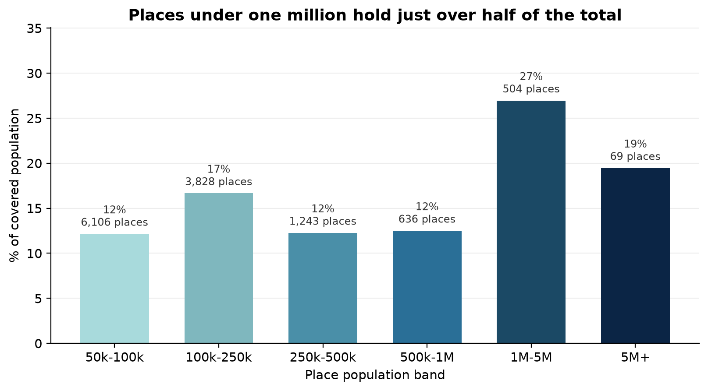

# How Uneven Is the World's Urban Population?

A small, reproducible analysis of where the world's urban population sits: across countries, and
across the city-size distribution.


## Research question

If you rank the world's cities by population, how concentrated is urban population in a few
countries and a few very large cities - and does the size distribution follow the rank-size
("Zipf") pattern that urban economists expect?

## Dataset and permissions

* **Source:** GeoNames `cities15000` dump, <https://download.geonames.org/export/dump/>
  (file `cities15000.zip`, downloaded 2026-10-18).
* **License:** Creative Commons Attribution 4.0 (CC BY 4.0). Attribution is given here and in the
  notebook; the derived extract is redistributed under the same license.
* **What this repository ships:** `data/world_cities_pop_50k.csv`, the 12,392 places with
  population >= 50,000, with the columns `City, Country, Country_Code, Latitude, Longitude,
  Population`. The script filters and renames nothing else, so the analysis can be reproduced
  from this file alone. The full dump can be re-downloaded from the URL above.
* **No personal data:** the file contains only public place names, coordinates and population
  counts. No API keys or credentials are used or stored.

## Methods and tools

* **Python 3** with `pandas` (loading, cleaning, country aggregation, size bands), `numpy`
  (log-log power-law fit by ordinary least squares) and `matplotlib` (figures).
* Cleaning: drop rows with missing coordinates or population, drop duplicate
  `(City, Country, Population)` rows, cast population to integer, sort descending by population.
  After cleaning: **12,386 places in 187 countries/territories**, covering **3.49 billion** people.
* Country totals are sums of the included places; the rank-size fit is a two-parameter power law
  on log ranks and log population, reported over ranks 100-10,000.

## Key findings

1. **Country concentration is extreme.** The top 15 countries hold **65.1%** of the covered
   population and China alone **24.4%** (India 8.4%, Brazil 4.5%, United States 4.4%).
2. **The head breaks the rank-size rule.** Ranks 100-10,000 follow a power law with slope
   **-0.95** (R^2 = 0.998), essentially the classic Zipf value. Extrapolated to rank 1 it would
   predict a city of about 300 million; Shanghai, the largest place in the data, has 24.9 million,
   an order of magnitude below the line. The 100 largest places are far less dominant than the
   textbook rule predicts.
3. **The head is not the whole story.** Places under one million still hold **53.6%** of the
   covered population (46.4% live in places of one million or more), so an urban story told only
   through megacities misses most residents.




## One limitation

GeoNames mixes city-proper population with urban sub-units (districts) for some countries and
only lists places above 15,000, so absolute counts - especially the 187 Chinese places above one
million - overstate the number of distinct cities, and the snapshot has no time dimension, so it
cannot be used to study urban growth.

## How to run

```bash
python -m venv .venv
source .venv/bin/activate          # Windows: .venv\Scripts\activate
pip install -r requirements.txt
jupyter notebook notebooks/world_cities_analysis.ipynb
```

Then run all cells (`Kernel -> Restart & Run All`). The notebook reads
`../data/world_cities_pop_50k.csv`, takes a few seconds, rewrites the three figures into `figs/`
and the summary numbers into `notebooks/stats.json`.

Command line, without Jupyter:

```bash
jupyter nbconvert --to notebook --execute notebooks/world_cities_analysis.ipynb \
  --output world_cities_analysis.ipynb --ExecutePreprocessor.timeout=300
```

## Repository layout

```
data-science-project/
├── README.md
├── requirements.txt
├── data/world_cities_pop_50k.csv
├── figs/fig1_top_countries.png
├── figs/fig2_rank_size.png
├── figs/fig3_size_bands.png
└── notebooks/world_cities_analysis.ipynb   # executed, outputs included
```

## Status

Completed (self-directed practice project for CISC7204, University of Macau).
